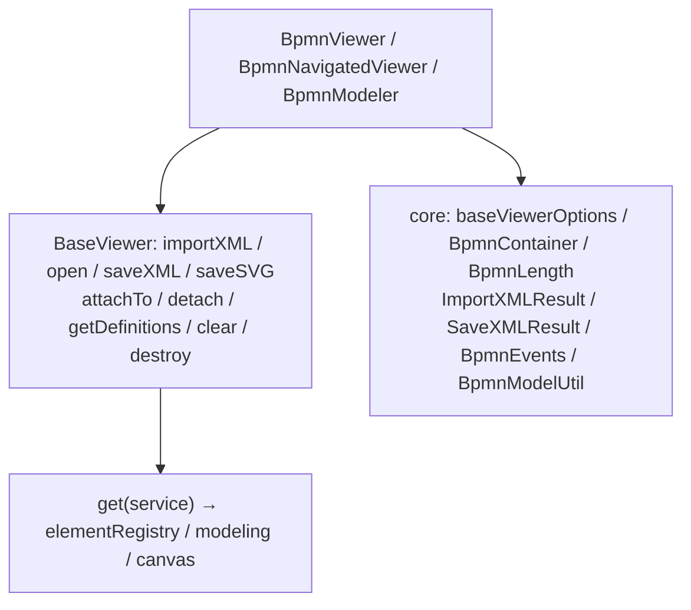

# API overview

## Package layout

| Package | Contents |
| --- | --- |
| `io.github.shijianjs.ktjs.bpmn` | `BpmnViewer`, `BpmnNavigatedViewer`, `BpmnModeler`, `BpmnBaseViewer`, `BpmnBaseModeler`, `BpmnListener`, `bpmnViewer`, `bpmnNavigatedViewer`, `bpmnModeler`, `on`, `onGuarded`, `service` |
| `…bpmn.core` | `BaseViewerOptions`, `baseViewerOptions`, `BpmnLength`, `BpmnContainer`, `SaveXMLOptions`, `saveXMLOptions`, `ImportXMLResult`, `SaveXMLResult`, `SaveSVGResult`, `BpmnModdleElement`, `BpmnElement`, `BpmnEvent`, `BpmnEvents`, `BpmnModelUtil` |

## Conventions this wrapper follows

- **Listeners never return a value.** bpmn-js reads any non-`undefined` return as “cancel the default
  action”, and a Kotlin `Unit`-returning lambda yields the `Unit` object rather than `undefined`. A
  listener registered for `import.parse.complete` that leaked `Unit` made every import fail with
  `no diagram to display`. The wrapper wraps the callback in a JS shim that returns nothing, and
  `on` hands back a `BpmnListener` so it can be removed by identity.
- **Element-or-selector became two methods.** `container` is `string | HTMLElement`, and
  `importXML` / `open` take `ModdleElement | string`; each is an opaque union type with factories
  (`BpmnContainer(element)` / `BpmnContainer(selector)`) plus `…Diagram` / `…ById` twins on the
  viewer.
- **`width` / `height` are `number | string`**, modelled as `BpmnLength` with
  `BpmnLength(640.0)` / `BpmnLength("100%")`.
- **Events carry typed names, untyped payloads.** `BpmnEvents` holds the lifecycle names so a typo
  is a compile error; the payload of each event (a shape, a canvas, the definitions object) stays
  on the event object, reached through `JsAny`.

## What is deliberately typed loosely

| Member | Kotlin type | Why |
| --- | --- | --- |
| `BaseViewerOptions.moddleExtensions` | `JsAny?` | upstream is `Record<string, {name, package}>`, a map of moddle packages keyed by prefix |
| `BaseViewerOptions.additionalModules` | `Array<JsAny>` | a `didi` module object: `{ __init__: […], service: ["type", Class] }` |
| `BpmnEvent` payloads | via `JsAny` | each event has its own payload type upstream |
| `get(service)` | `JsAny?` | the service map is generic over 40+ services; `service<T>(name)` casts on demand |

Every row is a real upstream shape, and each is recorded in `docs/development/technical-decisions.md`.
