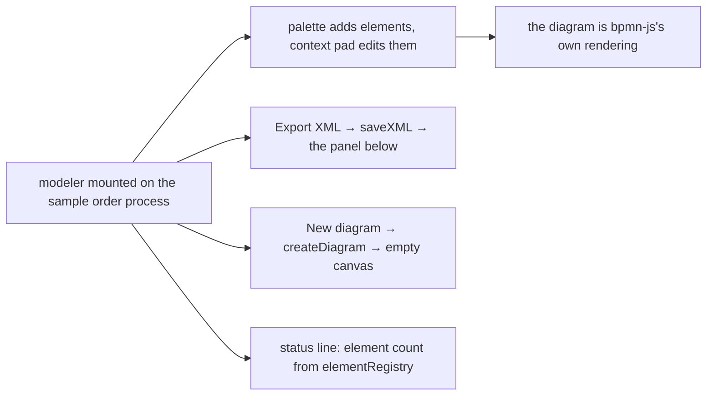

# Demo

The demo lives at [https://shijianjs.github.io/ktjs-bpmn/demo/](https://shijianjs.github.io/ktjs-bpmn/demo/).

The demo mounts a modeler on a sample order-handling process: the palette on the left adds
elements, the context pad edits them, and the diagram is the library's own rendering. Two buttons go
through the wrapper: **Export XML** calls `saveXML` and prints the serialised document into the panel
below, **New diagram** calls `createDiagram` and empties it again. The status line reads the
element count out of the `elementRegistry` service, and the language switch rewrites every label.

The language button in the page header switches between English and Simplified Chinese: every
visible string changes, not just the title.

The API reference is at [https://shijianjs.github.io/ktjs-bpmn/api/](https://shijianjs.github.io/ktjs-bpmn/api/), generated by Dokka from the published modules.
