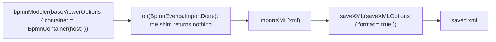

# Getting started

## Dependency

```kotlin
kotlin {
    js {
        binaries.executable()
        browser()
    }
    sourceSets {
        jsMain.dependencies {
            implementation("io.github.shijianjs:ktjs-bpmn:18.31.0-kt.1")
            // The public API exposes `kotlin-browser`'s `web.*` types, so a consumer must be able to
            // compile against them.
            implementation("org.jetbrains.kotlin-wrappers:kotlin-browser:2026.11.1")
        }
    }
}
```

Kotlin 2.4.21 or newer; the module emits ESM and targets `es2015` or later.

## Register the plugins

There is no plugin registry. `bpmn-js` splits its API across ES modules and the package is published as ES modules, so every import must name a **fully specified** path:

```kotlin
BpmnViewer      // bpmn-js/lib/Viewer.js
BpmnNavigatedViewer // bpmn-js/lib/NavigatedViewer.js
BpmnModeler     // bpmn-js/lib/Modeler.js
```

The wrapper does that for you. It also imports `bpmn-js/lib/util/ModelUtil.js` for the model helpers, and ships the stylesheets the library needs (`bpmn-js/dist/assets/{diagram-js.css,bpmn-js.css,bpmn-font/}`) with the npm dependency.



## First call

```kotlin
import io.github.shijianjs.ktjs.bpmn.bpmnModeler
import io.github.shijianjs.ktjs.bpmn.core.BpmnContainer
import io.github.shijianjs.ktjs.bpmn.core.BpmnEvents
import io.github.shijianjs.ktjs.bpmn.core.baseViewerOptions
import io.github.shijianjs.ktjs.bpmn.core.saveXMLOptions

fun mount(host: web.html.HTMLElement, xml: String) {
    val modeler = bpmnModeler(baseViewerOptions { container = BpmnContainer(host) })

    modeler.on(BpmnEvents.ImportDone) { println("imported: ${modeler.getDefinitions().type}") }

    modeler.importXML(xml).then {
        modeler.saveXML(saveXMLOptions { format = true }).then { saved ->
            println(saved.xml)
            Unit
        }
    }
}
```

The page needs the library's stylesheets, or the diagram renders unstyled and the palette has no icons.

## Build and test

```bash
./gradlew build                     # compile, Detekt, browser tests
./gradlew :ktjs-bpmn:jsBrowserTest     # only the wrapper's browser tests
./gradlew :docs:docusaurusStart     # documentation dev server
./gradlew pagesSite                 # docs at /, demo at /demo/, Dokka at /api/
```
