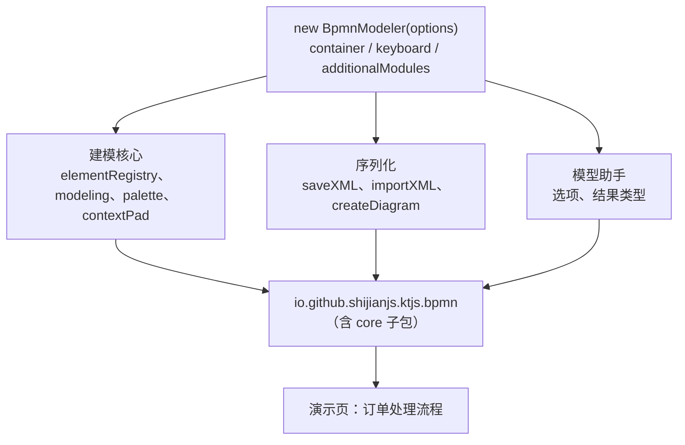

# 简介

`ktjs-bpmn` 是 [bpmn-js](https://github.com/bpmn-io/bpmn-js) 生态里 `bpmn-js` 18.31.0 的 Kotlin/JS wrapper：上游
`.d.ts` 里的每个类型和成员都落成可被编译器检查的 `external` 声明，不靠 `dynamic` 兜底。

封装覆盖 `bpmn-js` 18 的三个官方入口：`Viewer`、`NavigatedViewer`、`Modeler`，它们共享的 `BaseViewer` 表面（`importXML` / `importDefinitions` / `open`、`saveXML`、`saveSVG`、`attachTo`、`detach`、`getDefinitions`、`getModules`、`get` 服务访问器、`clear`、`destroy`、事件订阅）、`Modeler.createDiagram`、查看器选项（`width`、`height`、`position`、`container`、`moddleExtensions`、`additionalModules`）、promise 的结果类型、生命周期事件名，以及 `bpmn-js/lib/util/ModelUtil` 的四个模型助手（`is`、`isAny`、`getBusinessObject`、`getDi`）。

## 封装了哪些包

| 模块 | Gradle 坐标 | 上游 |
| --- | --- | --- |
| `ktjs-bpmn` | `io.github.shijianjs:ktjs-bpmn` | `bpmn-js` 18.31.0 |

一个 npm 包、一个 Gradle 模块、一个 Kotlin 包（`io.github.shijianjs.ktjs.bpmn`），选项、结果类型与模型助手放在 `core` 子包。

一个建模器对象持有整张图：wrapper 决定你能碰哪些服务与调用，流程本身由库画、由库编辑。

## 许可证

wrapper 自身是 MIT。上游 `bpmn-js` 的许可证与 wrapper 不同，商用前请读
[许可证说明](guide/license.md)。

## 接下来

- [快速开始](guide/getting-started.md) — 加依赖、写第一个调用、跑构建。
- [API 概览](guide/api-overview.md) — 包结构、类型映射约定、常用写法。
- [演示页](guide/demo.md) — 浏览器里直接看效果。
